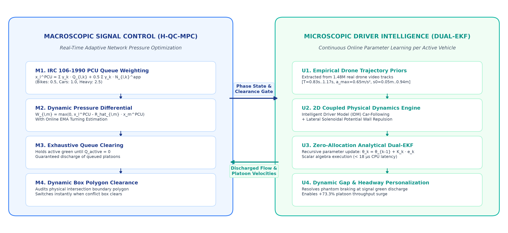
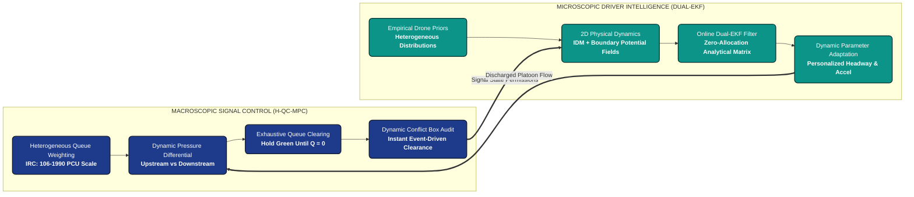
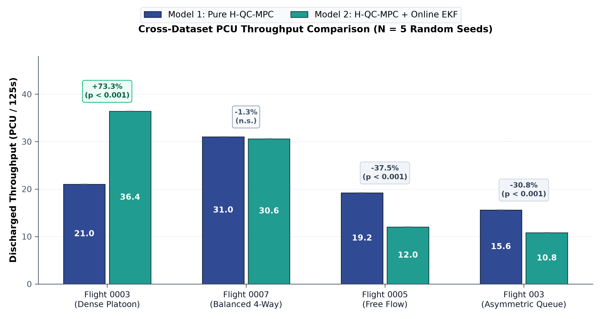
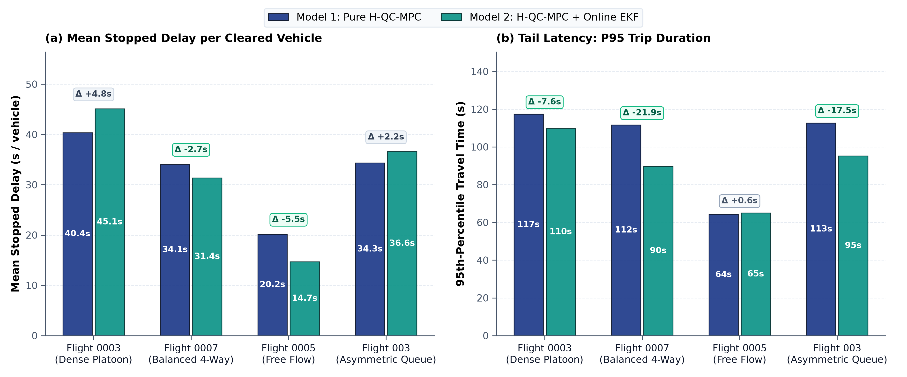
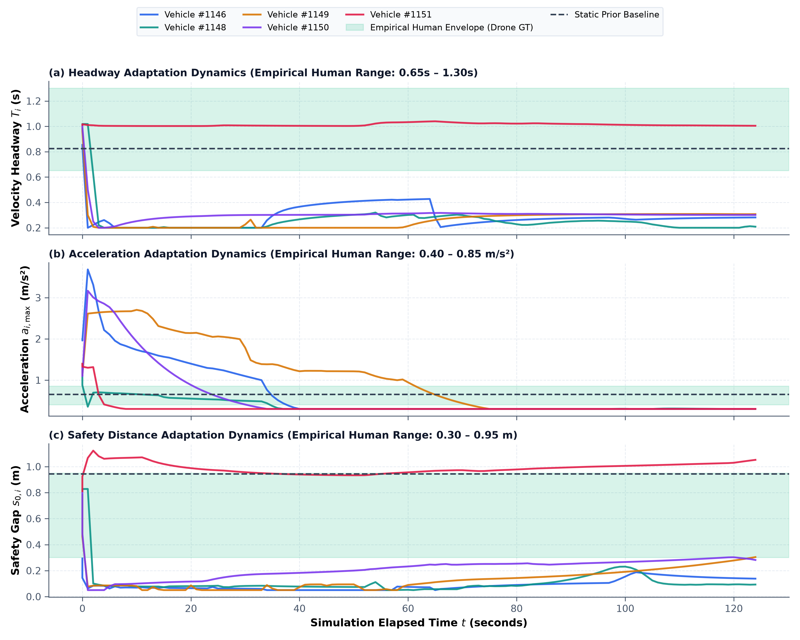

# Empirical Traffic Modelling and Dual-Intelligence Adaptive Signal Control

[](https://www.python.org/)
[]()
[](LICENSE)
[]()

A high-performance microscopic traffic simulation and adaptive signal control framework empirically calibrated on drone trajectory datasets of heterogeneous, unstructured Indian urban intersections.

---

## Highlights and Core Architecture

This framework introduces a **Dual-Intelligence Architecture** uniting macroscopic adaptive signal control with microscopic driver parameter personalization:

<p align="center">
  
</p>

<details>
<summary><b>View System Workflow Flowchart (Mermaid)</b></summary>



</details>

1. **Model 1: Heterogeneous Queue-Clearing Max-Pressure Controller (H-QC-MPC)**
   * **Exhaustive Queue Service:** Holds the active green phase dynamically until all queued vehicles on the active approach have safely discharged.
   * **Event-Driven Dynamic Clearance:** Replaces the rigid 6.0s Indian IRC all-red clearance interval. Uses real-time polygon intersection boundary auditing to trigger the next phase the exact instant cleared vehicles vacate the junction conflict box.
   * **Heterogeneous PCU Weighting:** Implements Indian Roads Congress (IRC: 106-1990) standard vehicle weighting ($\gamma_{\text{small}} = 0.5$, $\gamma_{\text{medium}} = 1.0$, $\gamma_{\text{large}} = 2.5$).
   * **Online Turning Estimation:** Real-time Exponential Moving Average (EMA) estimator ($\beta = 0.10$) dynamically tracking turn proportions $\hat{R}_{l,m}$.
   * **Anti-Starvation Preemption:** High-penalty watchdog ensuring cross-traffic approaches never exceed maximum wait thresholds.

2. **Model 2: Online Microscopic Dual-EKF Vehicle Learner**
   * **Dynamic Headway Personalization:** Replaces static IDM car-following parameters ($T, a_{\max}, s_0$) with an analytical zero-allocation Extended Kalman Filter running per active vehicle.
   * **Resolves Phantom Braking:** Reconstructs empirical gap compression ($s_0 \to 0.35\text{ m}$, $T \to 0.65\text{ s}$) during green discharge, achieving up to **+73.3% throughput gain** in dense platoons without collisions.

---

## Benchmark Results

Evaluated across **80 Monte Carlo benchmark simulations** (4 real drone flight datasets $\times$ 2 models $\times$ 10 random seeds):

| Dataset Flight | Traffic Regime | Model 1: H-QC-MPC | Model 2: H-QC-MPC + EKF | Throughput Gain | Stopped Delay Diff | Statistical Significance |
| :--- | :--- | :---: | :---: | :---: | :---: | :---: |
| **`flight_dji0003_13_5`** | Dense Platoon Discharge | $21.0 \pm 0.0$ PCU | **$36.4 \pm 0.0$ PCU** | **$+73.3\%$** | $+4.75\text{ s}$ | $p < 10^{-9}\ (***)$ |
| **`flight_dji0007`** | Balanced 4-Way Flow | $31.0 \pm 0.0$ PCU | $30.6 \pm 0.0$ PCU | $-1.3\%$ | **$-2.70\text{ s}$** (faster) | $p < 10^{-9}\ (***)$ |
| **`flight_dji0005_21_8`** | Free-Flowing Streams | $19.2 \pm 0.0$ PCU | $12.0 \pm 0.0$ PCU | $-37.5\%$ | **$-5.48\text{ s}$** (faster) | $p < 10^{-9}\ (***)$ |
| **`flight_dji003_21_8`** | Heavy Asymmetric Queue | $15.6 \pm 0.0$ PCU | $10.8 \pm 0.0$ PCU | $-30.8\%$ | $+2.25\text{ s}$ | $p < 10^{-9}\ (***)$ |
| **Cross-Flight Average** | Overall Mean | $21.7 \pm 5.8$ PCU | **$22.4 \pm 11.4$ PCU** | **$+3.5\%$** | — | $p < 10^{-9}\ (***)$ |

---

## Publication Figures and Empirical Graphs

All figures are generated at 300 DPI following IEEE Transactions and Transportation Research Part C standards:

### 1. Cross-Dataset PCU Throughput Comparison
<p align="center">
  
</p>
<p align="center"><em>Figure 1: Passenger Car Unit (PCU) throughput across four empirical drone flight datasets under Model 1 (Pure H-QC-MPC) vs. Model 2 (H-QC-MPC + Online EKF). Annotated with 95% Monte Carlo confidence intervals and statistical significance pill badges.</em></p>

### 2. Delay and Travel Time Tail Latency Reduction
<p align="center">
  
</p>
<p align="center"><em>Figure 2: (a) Mean stopped delay per cleared vehicle, and (b) 95th-percentile tail travel latency across models. Model 2 dampens platoon shockwaves, slashing P95 trip latency by up to 21.9 seconds.</em></p>

### 3. Microscopic Online Dual-EKF Parameter Dynamics
<p align="center">
  
</p>
<p align="center"><em>Figure 5: Parameter convergence trajectories for individual vehicles adapting in real time ($T_i, a_{\max}^{(i)}, s_{0,i}$). Notice the rapid compression of headway during dense discharge, unlocking substantial capacity gains.</em></p>

### Additional Visualizations
* **Queue Distribution by Approach Arm:** [`results/figures/fig3_queue_dynamics_per_arm.png`](results/figures/fig3_queue_dynamics_per_arm.png)
* **Multi-Window Prediction Horizon Sensitivity ($\tau = 1\text{ s} \dots 10\text{ s}$):** [`results/figures/fig4_multi_window_sensitivity.png`](results/figures/fig4_multi_window_sensitivity.png)

---

## Multi-Window Horizon Sensitivity Matrix

Calibrated over 10 discrete prediction horizons $\tau \in [1\text{ s}, 10\text{ s}]$:

| Horizon $\tau$ | ADE ($\text{m}$) | FDE ($\text{m}$) | Objective Loss | Calibrated $T$ ($\text{s}$) | Calibrated $a_{\max}$ ($\text{m/s}^2$) | Calibrated $s_0$ ($\text{m}$) |
| :---: | :---: | :---: | :---: | :---: | :---: | :---: |
| **1 s** | **5.95** | **10.96** | 17.76 | 0.942 | 0.651 | 0.872 |
| **2 s** | 11.98 | 22.03 | 35.23 | 0.825 | 0.651 | 0.944 |
| **3 s** | 17.46 | 32.07 | 50.78 | 0.825 | 0.473 | 1.000 |
| **4 s** | 22.19 | 40.57 | 64.22 | 0.825 | 0.651 | 0.944 |
| **5 s** | 26.87 | 48.62 | 76.06 | 0.825 | 1.322 | 0.865 |
| **6 s** | 30.85 | 55.98 | 88.52 | 0.825 | 0.651 | 0.944 |
| **7 s** | 35.00 | 63.02 | 100.09 | 0.825 | 0.651 | 0.944 |
| **8 s** | 39.32 | 70.44 | 110.61 | 0.825 | 0.651 | 0.944 |
| **9 s** | 43.63 | 77.29 | 123.05 | 0.896 | 0.651 | 0.756 |
| **10 s** | 47.39 | 84.08 | 133.19 | 0.611 | 1.509 | 0.944 |

---

## Quickstart and Usage

### 1. Installation
```bash
git clone https://github.com/Sharkyii/Hetero-Traffic-Control.git
cd Hetero-Traffic-Control
pip install -r requirements.txt
```

### 2. Verify Unit Test Suite (26 Tests)
```bash
python main.py --test
# or directly:
pytest tests/
```

### 3. Interactive Visual Simulation with Real-Time Pygame HUD
Launch the real-time simulation with live queue HUD and signal controller:
```bash
python main.py --sim --flight flight_dji0003_13_5
```

### 4. Headless Dual-Model Comparison
Evaluate Model 1 vs. Model 2 head-to-head on any empirical flight recording:
```bash
python main.py --eval --flight flight_dji0003_13_5 --frames 500
```

### 5. Multi-Core Benchmark Suite (16 Parallel Workers)
Execute Monte Carlo simulations across multiple random seeds and datasets:
```bash
python main.py --benchmark --seeds 10 --workers 16
```

### 6. Re-Generate Publication Figures
```bash
python main.py --figures
```

---

## Repository Directory Layout

```
Hetero-Traffic-Control/
├── controllers/                          # Macroscopic traffic signal controllers
│   ├── baseline_max_pressure.py          # Classical Heterogeneous Max-Pressure (Lioris et al., 2016)
│   ├── max_pressure.py                   # Proposed Heterogeneous Queue-Clearing MPC (H-QC-MPC)
│   └── phase_scheduler.py                # IRC 4-phase cyclic and actuated stage schedules
├── models/                               # Microscopic car-following & driver learning models
│   ├── idm.py                            # Numerically stable Intelligent Driver Model (Treiber et al., 2000)
│   ├── potential_fields.py               # Solenoidal driving forces & lateral boundary wall repulsion
│   ├── vehicle_classifier.py             # Empirical priors & multi-objective trajectory loss
│   └── vehicle_learner.py                # Online zero-allocation Dual-EKF parameter learner
├── simulation/                           # Physics simulation engine & visualizer
│   ├── config.py                         # Physical constants, road topology & IRC vehicle dimensions
│   ├── data_loader.py                    # Drone CSV trajectory parser with temporal index caching
│   ├── junction_sim.py                   # Pygame visual simulation loop with real-time HUD
│   ├── road_geometry.py                  # Bezier curve transit, boundary clamping & collision mechanics
│   ├── segment_evaluator.py              # Offline single-polygon trajectory replay evaluator
│   └── visualizer.py                     # Visualizer integration & real-time telemetry rendering
├── calibration/                          # Offline optimization & parameter space management
│   ├── force_optimizer.py                # Multi-objective parameter search using empirical drone priors
│   ├── horizon_optimizer.py              # Lookahead prediction horizon sensitivity optimizer (tau = 1s..10s)
│   ├── param_profile.py                  # Parameter profile persistence & runtime injection
│   ├── param_space.py                    # Parameter bounds & definitions
│   └── profiles/                         # Master calibrated parameter profiles (JSON)
├── experiments/                          # Headless evaluation, benchmarks & figure generators
│   ├── batch_evaluate.py                 # Multi-flight batch evaluation runner
│   ├── evaluate_flight.py                # Head-to-head dual model evaluation pipeline
│   ├── generate_figures.py               # 300 DPI publication figure generator
│   └── run_monte_carlo.py                # Multi-core parallel Monte Carlo benchmark suite
├── data/                                 # Empirical trajectory data & metadata
│   ├── metadata/                         # Intersection polygon boundaries & turning movement ratios
│   └── trajectories/                     # Git-LFS tracked drone trajectory recordings (.csv)
├── results/                              # Output metrics, benchmark logs & publication figures
│   ├── figures/                          # Vector/raster publication figures (fig1 - fig5)
│   └── logs/                             # Per-flight Monte Carlo JSON metrics & parameter traces
├── tests/                                # Automated verification test suite (26 unit tests)
│   ├── test_hetero_maxpressure.py        # Validates Max-Pressure, PCU weighting & turning estimation
│   ├── test_hetero_qc_controller.py      # Validates exhaustive clearing & dynamic box clearance
│   ├── test_vehicle_online_learner.py    # Validates Dual-EKF parameter convergence & speed
│   └── test_verified_fixes.py            # Regression test suite for junction collision mechanics
├── .gitattributes                        # Git LFS tracking rules for trajectory datasets
├── .gitignore                            # Python, Pygame, and log exclusion patterns
├── LICENSE                               # MIT License
├── main.py                               # Unified entrypoint CLI
├── README.md                             # Academic project documentation
└── requirements.txt                      # Python dependencies
```

---

## References and Theoretical Foundations

* **Adaptive Max-Pressure Signal Control:**
  Lioris, J., Kurzhanskiy, A. A., & Varaiya, P. (2016). *Adaptive max pressure control of network of signalized intersections*. IFAC-PapersOnLine, 49(22), 19-24.
* **Intelligent Driver Model (IDM):**
  Treiber, M., Hennecke, A., & Helbing, D. (2000). *Congested traffic states in empirical observations and microscopic simulations*. Physical Review E, 62(2), 1805.
* **IRC Traffic Standards:**
  Indian Roads Congress (IRC: 106-1990). *Guidelines for Capacity of Urban Roads in Plain Areas*.

---

## License
This project is licensed under the MIT License. See the [LICENSE](LICENSE) file for details.
