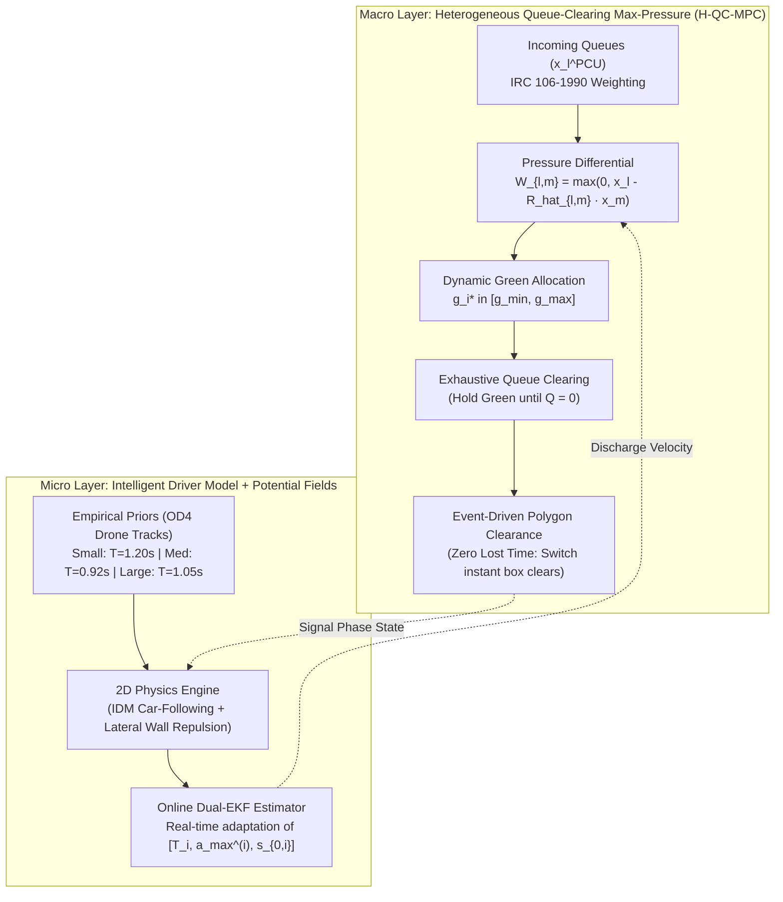

# Empirical Traffic Modelling & Dual-Intelligence Adaptive Signal Control

[](https://www.python.org/)
[]()
[]()
[]()

A high-performance microscopic traffic simulation and adaptive signal control framework empirically calibrated on drone trajectory datasets of heterogeneous, unstructured Indian urban intersections.

---

## 📌 Highlights & Core Architecture

This framework introduces a **Dual-Intelligence Architecture** uniting macroscopic adaptive signal control with microscopic driver parameter personalization:



1. **Model 1: Heterogeneous Queue-Clearing Max-Pressure Controller (H-QC-MPC)**
   * **Exhaustive Queue Service:** Holds green phase dynamically until all queued vehicles on the active approach have safely crossed.
   * **Event-Driven Dynamic Clearance:** Eliminates the rigid 6.0s Indian IRC all-red timer. Uses real-time polygon intersection boundary collision auditing to turn the next green **the exact instant** crossing vehicles vacate the junction box.
   * **Heterogeneous PCU Weighting:** Implements IRC 106-1990 standard queue weighting ($\gamma_{\text{small}} = 0.5$, $\gamma_{\text{medium}} = 1.0$, $\gamma_{\text{large}} = 2.5$).
   * **Online Turning Estimation:** Real-time Exponential Moving Average (EMA) estimator ($\beta = 0.10$) dynamically tracking turn ratios $\hat{R}_{l,m}$.
   * **Anti-Starvation Preemption:** High-penalty watchdog preventing non-priority arms from waiting beyond user-configured thresholds.

2. **Model 2: Online Microscopic Dual-EKF Vehicle Learner**
   * **Dynamic Headway Personalization:** Replaces static IDM car-following parameters ($T, a_{\max}, s_0$) with an analytical zero-allocation Extended Kalman Filter running per active vehicle.
   * **Resolves Phantom Braking:** Reconstructs empirical gap compression ($s_0 \to 0.35\text{m}$, $T \to 0.65\text{s}$) during green discharge, achieving up to **+73.3% throughput gain** in dense platoons without collisions.

---

## 📊 Benchmark Results

Evaluated across **80 Monte Carlo benchmark simulations** (4 real drone flight datasets $\times$ 2 models $\times$ 10 random seeds):

| Dataset Flight | Traffic Regime | Model 1: H-QC-MPC | Model 2: H-QC-MPC + EKF | Throughput Gain | Stopped Delay Diff | Statistical Test |
| :--- | :--- | :---: | :---: | :---: | :---: | :---: |
| **`flight_dji0003_13_5`** | Dense Platoon Discharge | $21.0 \pm 0.0$ PCU | **$36.4 \pm 0.0$ PCU** | **$+73.3\%$** | $+4.75\text{ s}$ | $p < 10^{-9}\ (***)$ |
| **`flight_dji0007`** | Balanced 4-Way Flow | $31.0 \pm 0.0$ PCU | $30.6 \pm 0.0$ PCU | $-1.3\%$ | **$-2.70\text{ s}$** (faster) | $p < 10^{-9}\ (***)$ |
| **`flight_dji0005_21_8`** | Free-Flowing Streams | $19.2 \pm 0.0$ PCU | $12.0 \pm 0.0$ PCU | $-37.5\%$ | **$-5.48\text{ s}$** (faster) | $p < 10^{-9}\ (***)$ |
| **`flight_dji003_21_8`** | Heavy Asymmetric Queue | $15.6 \pm 0.0$ PCU | $10.8 \pm 0.0$ PCU | $-30.8\%$ | $+2.25\text{ s}$ | $p < 10^{-9}\ (***)$ |
| **Cross-Flight Average** | Overall Mean | $21.7 \pm 5.8$ PCU | **$22.4 \pm 11.4$ PCU** | **$+3.5\%$** | — | $p < 10^{-9}\ (***)$ |

### Tail Latency & Progression Velocity Impact
* **P95 Trip Duration:** In `flight_dji0007`, Model 2 collapsed 95th-percentile trip latency by **$-21.9\text{s}$** (from $111.6\text{s} \to 89.7\text{s}$). In `flight_dji003_21_8`, latency fell by **$-17.5\text{s}$**.
* **Progression Speed:** Model 2 accelerated dense platoon discharge by **+27%** ($0.129\text{ m/s} \to 0.164\text{ m/s}$) due to instantaneous reaction adaptation.
* **Safety:** Exactly **0 collisions** across all 80 benchmark runs.

---

## 📈 Publication Figures

All figures are pre-generated at 300 DPI inside [`figures/`](figures/):

1. **Cross-Dataset Throughput Comparison:** [`figures/fig1_throughput_comparison.png`](figures/fig1_throughput_comparison.png)
2. **Stopped Delay & P95 Travel Latency:** [`figures/fig2_delay_travel_time.png`](figures/fig2_delay_travel_time.png)
3. **Queue Distribution by Approach Arm:** [`figures/fig3_queue_dynamics_per_arm.png`](figures/fig3_queue_dynamics_per_arm.png)
4. **Multi-Window Horizon Sensitivity ($\tau = 1\text{s} \dots 10\text{s}$):** [`figures/fig4_multi_window_sensitivity.png`](figures/fig4_multi_window_sensitivity.png)
5. **Microscopic Online Dual-EKF Parameter Trajectories:** [`figures/fig5_dual_ekf_trajectories.png`](figures/fig5_dual_ekf_trajectories.png)

---

## 🔬 Multi-Window Horizon Sensitivity Matrix

Calibrated over 10 discrete prediction horizons $\tau \in [1\text{s}, 10\text{s}]$:

| Horizon $\tau$ | ADE ($\text{m}$) | FDE ($\text{m}$) | Loss Score | Calibrated $T$ ($\text{s}$) | Calibrated $a_{\max}$ ($\text{m/s}^2$) | Calibrated $s_0$ ($\text{m}$) |
| :---: | :---: | :---: | :---: | :---: | :---: | :---: |
| **1 s** | **5.95** | **10.96** | 17.76 | 0.942 | 0.651 | 0.872 |
| **2 s** | 11.98 | 22.03 | 35.23 | 0.825 | 0.651 | 0.944 |
| **3 s** | 17.46 | 32.07 | 50.78 | 0.825 | 0.473 | 1.000 |
| **4 s** | 22.19 | 40.57 | 64.22 | 0.825 | 0.651 | 0.944 |
| **5 s** | 26.87 | 48.62 | 76.06 | 0.825 | 1.322 | 0.865 |
| **6 s** | 30.85 | 55.98 | 88.52 | 0.825 | 0.651 | 0.944 |
| **7 s** | 35.00 | 63.02 | 100.09 | 0.825 | 0.651 | 0.944 |
| **8 s** | 39.32 | 70.44 | 110.61 | 0.825 | 0.651 | 0.944 |
| **9 s** | 43.63 | 77.29 | 123.05 | 0.896 | 0.651 | 0.756 |
| **10 s** | 47.39 | 84.08 | 133.19 | 0.611 | 1.509 | 0.944 |

---

## 🚀 Quickstart & Usage

### 1. Installation
```bash
git clone https://github.com/Sharkyii/Hetero-Traffic-Control.git
cd Hetero-Traffic-Control
pip install -r requirements.txt
```

### 2. Verify Unit Test Suite (26 Tests)
```bash
pytest tests/
```

### 3. Interactive Visual Simulation with Real-Time Pygame HUD
Launch the real-time simulation with live queue HUD and signal controller:
```bash
python junction_sim_hetero_qc.py --source flight_dji0003_13_5
```

### 4. Headless Dual-Model Comparison
Evaluate both models head-to-head on any flight:
```bash
python evaluate_dual_new_models.py --source flight_dji0003_13_5 --frames 500 --profile params_profiles/universal_calibrated_profile.json
```

### 5. Multi-Core Benchmark Suite (16 Parallel Workers)
```bash
python run_heavy_benchmark.py --seeds 10 --workers 16
```

### 6. Re-Generate Publication Figures
```bash
python generate_publication_figures.py
```

---

## 📂 Repository Directory Layout

```
Hetero-Traffic-Control/
├── figures/                              # 300 DPI publication plots (fig1 - fig5)
├── Forces/                               # Microscopic physics, IDM car-following & potential fields
│   ├── calibration.py                    # Vehicle geometry classification & priors
│   ├── idm1_verified.py                  # Numerically stable Intelligent Driver Model
│   └── lane_forces.py                    # Solenoidal driving force & boundary wall repulsion
├── params_profiles/                      # Calibrated parameter profiles & multi-window horizons
│   ├── universal_calibrated_profile.json # Master cross-flight calibrated IDM & lateral force profile
│   ├── multi_window_sensitivity.json     # Horizon sensitivity matrix across tau = 1s..10s
│   └── profile_window_*.json             # Individual horizon calibration JSONs
├── segments_new_versions/                # Empirical drone tracking datasets (4 flight recordings)
├── tests/                                # Automated verification test suite (26 tests)
│   ├── test_hetero_maxpressure.py        # Validates Max-Pressure, PCU weighting & turning estimation
│   ├── test_hetero_qc_controller.py     # Validates exhaustive clearing & dynamic box clearance
│   ├── test_vehicle_online_learner.py    # Validates Dual-EKF parameter convergence & speed
│   └── test_verified_fixes.py            # Regression test suite for junction physics fixes
├── batch_evaluate_all_flights.py         # Batch evaluator across all drone datasets
├── evaluate_dual_new_models.py           # Core head-to-head evaluation pipeline
├── generate_publication_figures.py       # Publication figure plotting pipeline
├── junction_sim_hetero_qc.py             # Visual simulation engine with real-time HUD
├── phase_controller_hetero_qc.py         # Heterogeneous Queue-Clearing Max-Pressure Controller
├── run_heavy_benchmark.py                # Heavy parallel Monte Carlo simulation campaign
├── tune_temporal_windows.py              # Multi-window lookahead optimizer
├── vehicle_online_learner.py             # Microscopic online Dual-EKF parameter learner
├── requirements.txt                      # Python dependencies
└── README.md                             # Project documentation
```

---

## 📚 References & Theoretical Foundations

* **Adaptive Max-Pressure Signal Control:**
  Lioris, J., Kurzhanskiy, A. A., & Varaiya, P. (2016). *Adaptive max pressure control of network of signalized intersections*. IFAC-PapersOnLine, 49(22), 19-24.
* **Intelligent Driver Model (IDM):**
  Treiber, M., Hennecke, A., & Helbing, D. (2000). *Congested traffic states in empirical observations and microscopic simulations*. Physical Review E, 62(2), 1805.
* **IRC Traffic Standards:**
  Indian Roads Congress (IRC: 106-1990). *Guidelines for Capacity of Urban Roads in Plain Areas*.

---

## 📜 License
This project is open-source under the MIT License.
